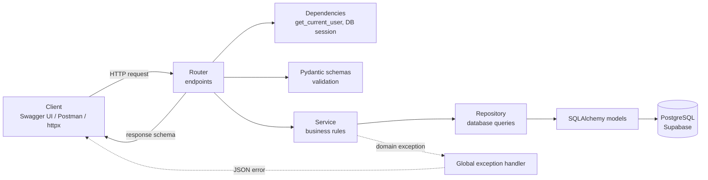
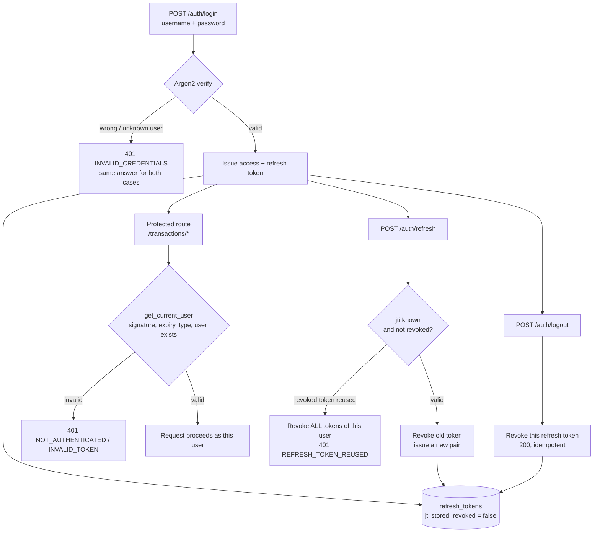
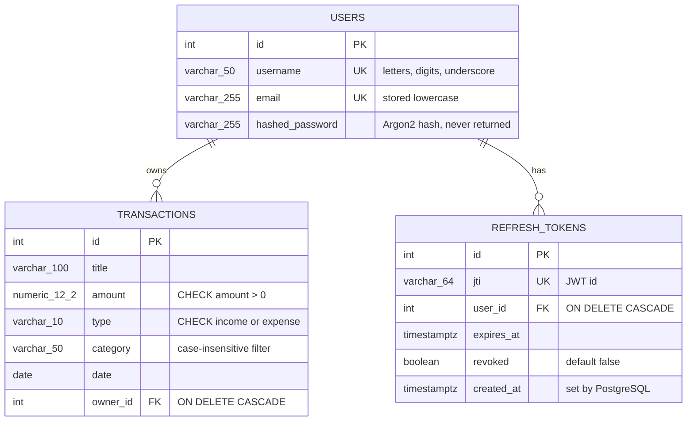

# Expense Tracker API - FastAPI + Async SQLAlchemy + PostgreSQL + JWT + PyTest

A production-style REST API for tracking personal **income and expenses**. Users register, log in, and manage **only their own** transactions, with filtering by type, category and amount range.

Built as the Module 24 Mid-Term project of the Phitron AI/ML course, but deliberately taken beyond the exam requirements: a fully **asynchronous** stack, a layered feature-based architecture, **refresh-token rotation with reuse detection**, database-level safety rules, and a **198-test PyTest suite** with shareable HTML and Allure reports.

🔗 **Live Demo:** [ph-aiml-b1-genai-mod24-midtermexam.onrender.com/](https://ph-aiml-b1-genai-mod24-midtermexam.onrender.com/)
📖 **Interactive API docs:** [/docs (Swagger UI)](https://ph-aiml-b1-genai-mod24-midtermexam.onrender.com/docs) · [/redoc (ReDoc)](https://ph-aiml-b1-genai-mod24-midtermexam.onrender.com/redoc)

> The live service runs on a free hosting plan, so the first request after a period of inactivity can take a little longer while the server wakes up.

---

## Project Highlights

- ✅ **Fully asynchronous** request path: async SQLAlchemy 2.x sessions on the psycopg 3 driver
- ✅ **Feature-based, layered architecture**: router → service → repository → model, each feature in its own folder
- ✅ **JWT authentication** with short-lived access tokens and database-tracked refresh tokens
- ✅ **Refresh-token rotation + reuse detection**: a stolen, already-used refresh token revokes every session of that user
- ✅ **Ownership-based authorization**: users can never read, change or delete another user's transactions (and cannot even tell whether they exist)
- ✅ **Exact money handling** with `NUMERIC(12, 2)` instead of floating point
- ✅ **Defence in depth**: Pydantic validation in the API **and** CHECK / FOREIGN KEY constraints in PostgreSQL
- ✅ **Argon2** password hashing, timing-attack-safe login, mass-assignment protection
- ✅ **Alembic** migrations with a predictable constraint naming convention
- ✅ **198 automated tests** (unit, API, database, migrations) on an isolated test database, with per-test transaction rollback
- ✅ **Test reports** as a single-file HTML report (pytest-html) and an interactive Allure 3 report

---

## Tech Stack

| Layer | Technology |
|---|---|
| Language | Python 3.12+ (developed on 3.14) |
| Web framework | FastAPI |
| Server | Uvicorn (ASGI) |
| Validation | Pydantic v2 |
| ORM | SQLAlchemy 2.x (async) |
| Database driver | psycopg 3 (async mode) |
| Database | PostgreSQL, hosted on Supabase (separate projects for development and testing) |
| Migrations | Alembic (async-aware `env.py`) |
| Configuration | pydantic-settings (`.env`) |
| Password hashing | Argon2 (argon2-cffi) |
| Tokens | JWT (PyJWT), HS256 |
| Testing | PyTest, pytest-asyncio, httpx (in-process `AsyncClient`), pytest-cov |
| Test reporting | pytest-html, allure-pytest + Allure Report 3 |
| Hosting | Render |

---

## Project Architecture

### Layered request flow

Every feature (`auth`, `users`, `transactions`) follows the same layers. Each layer only talks to the layer directly below it: the router never touches the database, and the repository knows nothing about HTTP.



---

## Authentication & Authorization

- **Access token** (15 minutes, configurable): sent as `Authorization: Bearer <token>` on every protected request. It is stateless and never stored.
- **Refresh token** (7 days, configurable): only used to obtain a new token pair. Its unique id (`jti`) is stored in the `refresh_tokens` table, so it can be revoked.
- Every token carries `sub`, `type`, `jti`, `iat` and `exp` claims. An access token cannot be used as a refresh token and vice versa.

### Token lifecycle



---

## Database Architecture

### Entity Relationship Diagram



---

## API Endpoints

### Authentication (public)

| Method | Path | Body | Success | Description |
|---|---|---|---|---|
| `POST` | `/auth/register` | username, email, password | `201` | Create an account. The password hash is never returned. |
| `POST` | `/auth/login` | username, password | `200` | Returns `access_token`, `refresh_token`, `token_type`, `expires_in` |
| `POST` | `/auth/refresh` | refresh_token | `200` | Rotates the refresh token and returns a new pair |
| `POST` | `/auth/logout` | refresh_token | `200` | Revokes the refresh token (safe to call twice) |

### Transactions (protected: `Authorization: Bearer <access_token>`)

| Method | Path | Success | Description |
|---|---|---|---|
| `POST` | `/transactions` | `201` | Create a transaction. The owner is the logged-in user. `date` defaults to today. |
| `GET` | `/transactions` | `200` | All of my transactions, newest date first |
| `GET` | `/transactions/filter` | `200` | My transactions filtered by query parameters (see below) |
| `GET` | `/transactions/{transaction_id}` | `200` | One of my transactions |
| `PUT` | `/transactions/{transaction_id}` | `200` | Partial update: only the fields that are sent are changed |
| `DELETE` | `/transactions/{transaction_id}` | `200` | Delete one of my transactions, returns a confirmation message |

### Filter query parameters

All parameters are optional and can be combined. Unknown parameters are rejected, so a typo never silently returns unfiltered data.

| Parameter | Example | Rule |
|---|---|---|
| `type` | `expense` | `income` or `expense` |
| `category` | `Food` | Case-insensitive exact match (`food`, `Food` and `FOOD` are the same) |
| `minimum_amount` | `100` | Inclusive, must be 0 or more |
| `maximum_amount` | `5000` | Inclusive, must not be smaller than `minimum_amount` |

Example: `/transactions/filter?type=expense&category=Food&minimum_amount=100&maximum_amount=5000`

---

## Project Structure

Only the folders relevant to this API are shown.

```
PH_AIML_B1_GenAI_Mod24_MidTermExam_Expense_Tracker_API_Project/
├── src/
│   ├── main.py                     # FastAPI app, lifespan startup checks, exception handler, routers
│   ├── core/
│   │   ├── config.py               # settings from .env (pydantic-settings)
│   │   ├── security.py             # Argon2 hashing, JWT create / decode
│   │   └── exceptions.py           # AppException base + global JSON error handler
│   ├── db/
│   │   ├── base.py                 # declarative base, naming convention, AsyncAttrs
│   │   └── session.py              # async engine, session factory, get_db dependency
│   ├── api/v1/
│   │   ├── api.py                  # collects all feature routers
│   │   └── deps.py                 # shared dependencies: DbSession, get_current_user
│   ├── shared/
│   │   └── schemas.py              # shared response schemas (MessageResponse)
│   └── features/
│       ├── users/                  # User model, schemas, repository, exceptions
│       ├── auth/                   # RefreshToken model + register / login / refresh / logout
│       └── transactions/           # Transaction model + CRUD + filter
│           ├── constants.py        # enums, limits, error codes
│           ├── models.py           # SQLAlchemy table
│           ├── schemas.py          # request / response / filter schemas
│           ├── exceptions.py       # feature-specific errors
│           ├── repository.py       # database queries only
│           ├── service.py          # business rules, ownership, commits
│           ├── dependencies.py     # service dependency
│           └── router.py           # HTTP endpoints
├── alembic/
│   ├── env.py                      # async migrations + connection sharing for tests
│   └── versions/                   # migration history
├── tests/
│   ├── conftest.py                 # test DB, rollback isolation, client, user / transaction factories, report hooks
│   ├── test_migrations.py
│   ├── core/                       # security unit tests
│   ├── api/                        # route-protection tests
│   ├── features/                   # mirrors src/features: schema, API and model tests
│   └── reports/                    # generated reports (gitignored)
├── alembic.ini
├── pyproject.toml                  # pytest, coverage and report configuration
├── package.json                    # Allure 3 CLI (report tooling only)
├── allurerc.mjs                    # Allure report configuration
├── requirements.txt
└── .env.example                    # list of required environment variables
```

---

## Running Locally

### Prerequisites

- Python 3.12 or newer
- Two PostgreSQL databases: one for development, one **only for tests** (two free Supabase projects work well)
- Node.js LTS, only if you want to build the Allure report

### Environment variables

Copy `.env.example` to `.env` and fill in the values. `.env` is never committed.

| Variable | Purpose |
|---|---|
| `SB_CONNECTION_STRING` | Development database (Supabase **Session pooler** connection string) |
| `SB_HOST`, `SB_PORT`, `SB_DATABASE`, `SB_USER`, `SB_PASSWORD` | Development database connection parameters |
| `SB_TESTDB_CONNECTION_STRING` | Test database connection string (**must differ** from the development one) |
| `SB_TESTDB_HOST`, `SB_TESTDB_PORT`, `SB_TESTDB_DATABASE`, `SB_TESTDB_USER`, `SB_TESTDB_PASSWORD` | Test database connection parameters |
| `SECRET_KEY` | Long random string used to sign JWTs |
| `ALGORITHM` | JWT algorithm, `HS256` |
| `ACCESS_TOKEN_EXPIRE_MINUTES` | Access token lifetime, e.g. `15` |
| `REFRESH_TOKEN_EXPIRE_DAYS` | Refresh token lifetime, e.g. `7` |

The `postgresql://` prefix copied from Supabase is converted to the async psycopg 3 driver automatically.

### Steps

1. Clone the repository and open the project folder.
2. Create a virtual environment: `python -m venv .venv`
3. Activate it: `.venv\Scripts\activate` on Windows, `source .venv/bin/activate` on macOS / Linux.
4. Install the dependencies: `pip install -r requirements.txt`
5. Create `.env` from `.env.example` and fill in your values.
6. Create the tables in the development database: `alembic upgrade head`
7. Start the server: `uvicorn src.main:app --reload`
8. On startup the app checks the configuration and the database connection, then serves the API at `http://127.0.0.1:8000`.
9. Open `http://127.0.0.1:8000/docs`, register a user, log in, click **Authorize**, paste the `access_token`, and try the transaction endpoints.

---

## Testing

- **Real PostgreSQL, not mocks**: tests run against a dedicated test database with the same schema as production.
- **Full isolation**: every test runs inside a transaction that is rolled back afterwards, so tests never affect each other and nothing needs to be cleaned up by hand.
- **No server needed**: requests go straight into the FastAPI app through `httpx.AsyncClient`.
- **Factories**: fixtures create fresh users and transactions on demand, so each test reads like a short story.
- **Safety guard**: the run stops immediately if the test database URL is the same as the development one.

### Running the tests

| Goal | Command |
|---|---|
| Run everything | `pytest` |
| With a coverage report | `pytest --cov` |
| One feature only | `pytest tests/features/transactions` |
| Tests whose name matches a word | `pytest -k filter` |
| Skip the migration tests | `pytest -m "not migrations"` |
| Stop at the first failure | `pytest -x` |

---

## Test Reports

Every `pytest` run writes two kinds of output into `tests/reports/` (gitignored):

| Report | Best for | Highlights |
|---|---|---|
| **pytest-html** | Quick sharing | One self-contained HTML file, opens anywhere, no extra tools |
| **Allure 3** | Technical analysis | Tests grouped by Epic → Feature, severity and tags, filters and search, every HTTP request and response attached, fixture setup / teardown timeline |

Passwords, access tokens and refresh tokens are masked as `***` in every report, so reports are safe to share.

### Generating the reports

1. Run the tests: `pytest`. The pytest-html report is ready at `tests/reports/pytest-html/report.html`.
2. Install the Allure CLI once: `npm install` (the version is pinned in `package.json`).
3. Build the Allure report: `npm run report:allure`
4. Open it in the browser: `npm run report:allure:open`. The report is also a single file at `tests/reports/allure-report/index.html`.

---

## Deployment

- **Database:** PostgreSQL on Supabase (online), using the Session pooler connection string.
- **Hosting:** Render web service.
- **Build:** install the packages from `requirements.txt`.
- **Before start:** apply migrations with `alembic upgrade head`.
- **Start:** run Uvicorn on host `0.0.0.0` and the port provided by Render (`$PORT`).
- **Configuration:** all values from `.env.example` are set as environment variables in the Render dashboard; no secrets live in the repository.

---

## 👤 Author

- **[Mohammad Zahid Kamal]** *Full Stack AI Enthusiast & Developer*
- *LinkedIn* [https://www.linkedin.com/in/md-zahid-kamal/]
- *Portfolio* [https://md-zahid-kamal.vercel.app/]

---

*Developed with ❤️ as part of an AI Exploration Project.*
